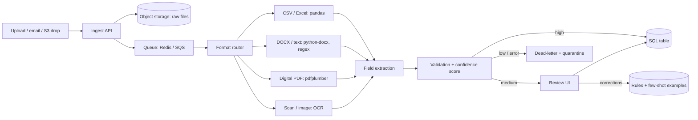

# Part 2: Multi-Format Document Ingestion and Tabularization

**Goal:** turn PDFs, scans, Excel/CSV, Word and text files into one validated table, with every uncertain record visible to a human.
A working proof of concept is in [`poc/pipeline.py`](../poc/pipeline.py).

## 1. End-to-end architecture

**Ingest and queue.** Files arrive by upload API, watched folder or email. Each file is hashed (SHA-256) so duplicates are skipped, stored untouched in object storage, and one job per file goes onto a queue (Celery + Redis for a small team, SQS for scale). Workers are stateless and scale horizontally; every job writes status (`queued, processing, accepted, review, failed`) to a `jobs` table so nothing disappears silently.

**Extraction by format.** The router uses the real file signature, not the extension. Cheapest reliable method first, heavier methods only as fallback:

| Input | Method | Why |
|---|---|---|
| CSV / Excel | pandas + fuzzy header mapping to the canonical schema | Already structured; the only problem is inconsistent column names. |
| DOCX / TXT | python-docx (paragraphs and tables), then regex key:value rules | Deterministic, free, fast, auditable. |
| Digital PDF | pdfplumber (text and tables) | Keeps layout and table cells; no OCR error introduced. |
| Scanned PDF / image | Detect empty text layer, then deskew and denoise (OpenCV), then Tesseract (or PaddleOCR / cloud OCR for hard scans) | OCR only when needed, because it is the main source of errors. |
| Unknown layouts | LLM-assisted extraction constrained to the JSON schema, run on the text/OCR output | Handles layouts no rule anticipated; used as fallback so cost and hallucination risk stay small. |

Rules first and LLM second is deliberate: rules are cheap and repeatable, the LLM covers the long tail. Every record stores which method produced it.

## 2. Validation and accuracy

**Per-field checks (pydantic or the `clean()` step in the PoC):** required fields present; types (dates parsed to ISO, amounts to float after stripping currency symbols and separators); ranges (amount > 0, date not in the future); formats (invoice number pattern, GSTIN/PAN checksum where relevant); allowed values for enums such as currency.

**Batch-level checks:** duplicates on (vendor, invoice number), outlier totals using the IQR rule (or per-vendor history), and schema drift (a source suddenly missing a column).

**Cross-checks:** line items must sum to the stated total; OCR and LLM extractions of the same field must agree, otherwise confidence drops.

**Confidence score** = method prior (table 0.95, regex 0.85, OCR 0.70) minus a penalty per failed check. Routing: `>= 0.85` auto-accept, `0.50-0.85` human review, `< 0.50` reject to dead-letter. Thresholds are tuned on a labelled sample so auto-accepted records hit a target precision (for example 99%).

**Raising accuracy over time.** Keep a labelled gold set per document type and run it on every pipeline change (field-level precision and recall). Use per-vendor templates once a layout is seen repeatedly. Store reviewer corrections and feed them back as new rules and few-shot examples.

## 3. Error handling and failure recovery

- **Corrupted or unsupported files:** magic-byte check and a safe open; failure is caught, the file is copied to quarantine with the reason, and the job is marked `failed`. Nothing crashes the worker.
- **Transient errors** (timeouts, OCR service down): retried with exponential backoff (2 to 3 attempts), then moved to a dead-letter queue that can be replayed after a fix.
- **Missing optional dependency or unsupported layout:** routed to review, not dropped.
- **Idempotency:** jobs keyed by file hash, so retries and replays never create duplicate rows.
- **Observability:** structured logs per job, metrics (throughput, failure rate, review rate, p95 latency), alerts when failure or review rate spikes.

**Human-in-the-loop.** Records in the medium band appear in a review screen showing the original file beside the extracted fields, with low-confidence fields highlighted. The reviewer approves or edits; the record is written to the table with `reviewed_by` and an audit trail. Corrections become training signal (section 2). The PoC writes this queue to `review_queue.csv`; production would expose it as a small web UI.

## 4. Security and data handling
Encrypt files at rest and in transit, restrict access by role, redact personal data before sending text to any external model, and keep an audit log of who changed which record.

## 5. Proof of concept and next steps
`poc/pipeline.py` implements routing, fuzzy header mapping, regex extraction, validation, duplicate and outlier detection, confidence routing, retries, quarantine and SQLite/CSV output. It runs on the included samples, which cover a clean table, a text invoice, an incomplete file, a duplicate, a bad date, an outlier and a corrupted file. Next: add the LLM fallback, the review UI, and the labelled gold set.
